<h1 align="center">dsh-im-companion
</h1>

<div align="center">

**中文** · [English](docs/README.en.md)

**dsh-im-companion 以助理和家的概念增强dsh-im的使用体验。**

你的 ⭐是我夜空中最亮的星。

*Give every agent a home — IM Companion handles the rest.*

[](https://www.npmjs.com/package/dsh-im-companion) [](https://www.npmjs.com/package/dsh-im-companion) [](https://github.com/FeatherHunter/dsh-im-companion/commits/master) [](LICENSE) [](https://github.com/xmanrui/dsh-im) [](https://github.com/FeatherHunter/dsh-im-companion/issues)

<table>
<tr>
<td align="center" valign="top" width="50%">
<strong>👇 有助理的工作区，一目了然。</strong>
<br>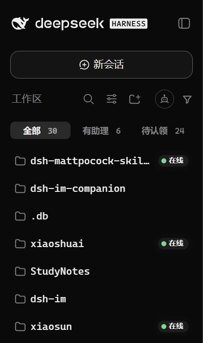
</td>
<td align="center" valign="top" width="50%">
<strong>👇 额外增强DSH原生会话状态。</strong>
<br>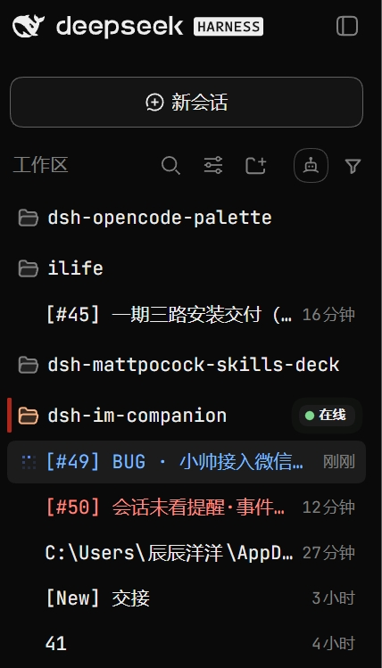
</td>
</tr>
</table>

**装它，1 分钟（先装 dsh-im，再装辅助）。**

</div>

<h2 align="center"><sub>INSTALL</sub><br>安装</h2>

<div align="center">

前置要求：[DSH](https://www.npmjs.com/package/@deepseek-ai/dsh)（DeepSeek Harness）+ [dsh-im](https://github.com/xmanrui/dsh-im)（IM 机器人本体）。

</div>

```bash
# 1 安装 DSH CLI（已装跳过）
npm install -g @deepseek-ai/dsh

# 2 先装本体 dsh-im（已装跳过，同样 --profile 必填）
dsh plugin --profile desktop add dsh-im
#     或者
dsh plugin --profile web add dsh-im

# 3 再装辅助（--profile 必填，装进实际使用的入口）
dsh plugin --profile desktop add dsh-im-companion
#     或者
dsh plugin --profile web add dsh-im-companion

# 锁定版本更稳（当前 0.2.22）
dsh plugin --profile desktop add dsh-im-companion@0.2.22 --registry https://registry.npmjs.org
```

<div align="center">

装完刷新页面即生效。若面板没有出现，请完全退出 DSH 后重新打开。

</div>

<details>
<summary>把安装交给你的 AI</summary>

复制下面这段发给你的 AI：

```text
请帮我安装 DeepSeek Harness 插件 dsh-im-companion（IM 辅助）。
先读仓库 README：https://github.com/FeatherHunter/dsh-im-companion
先确认我实际使用的 DSH 入口对应哪个 profile（桌面应用走 desktop，自启 web 服务走 web），
先确认 dsh-im 本体已装进同一个 profile（没装先装），再把辅助装进正确的 profile。
```

</details>

<details>
<summary>更新不生效时怎么装</summary>

下面以 desktop 为例，web 用户请把 --profile desktop 换成 --profile web：

```bash
dsh plugin --profile desktop add dsh-im-companion@0.2.22 --registry https://registry.npmjs.org
npx --yes @deepseek-ai/dsh plugin --profile desktop add dsh-im-companion
dsh plugin --profile desktop add dsh-im-companion@latest --registry https://registry.npmjs.org
```

</details>

升级 · 卸载：

```bash
dsh plugin --profile desktop update dsh-im-companion
dsh plugin --profile desktop remove dsh-im-companion
```


<h2 align="center"><sub>WHY</sub><br>为什么要做 IM 辅助</h2>

<div align="center">

dsh-im 掌管接入，dsh-im-companion 以助理和家的概念增强能力。

**家**：哪个工作区有助理在管、在不在线，尽收眼底；搬家拖一下就行。

<strong>👇 点“有助理”，只看已安家的。</strong>

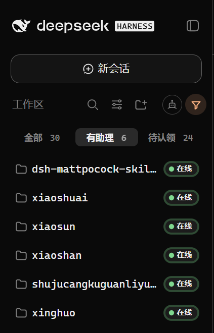

</div>

<h2 align="center"><sub>IN ACTION</sub><br>真机演示</h2>

<div align="center">

<strong>👇 进设置 → IM机器人增强：助理、渠道、在线状态一屏看尽。</strong>

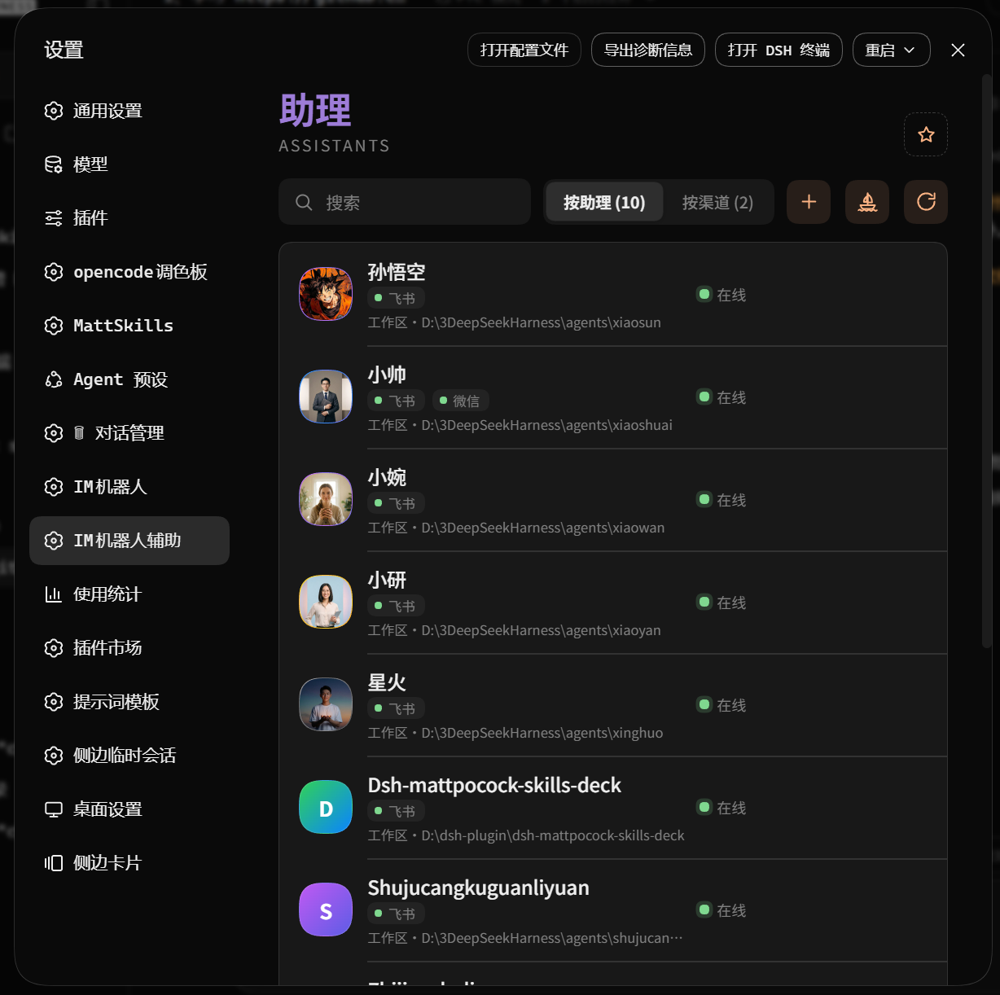

<strong>👇 切按渠道：同渠道助理排一排。</strong>

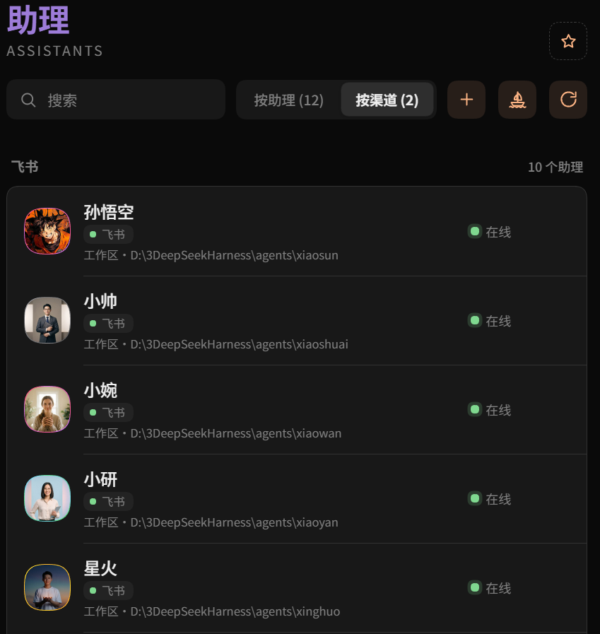

<strong>👇 点“添加接入”：选家后扫码即绑定。</strong>

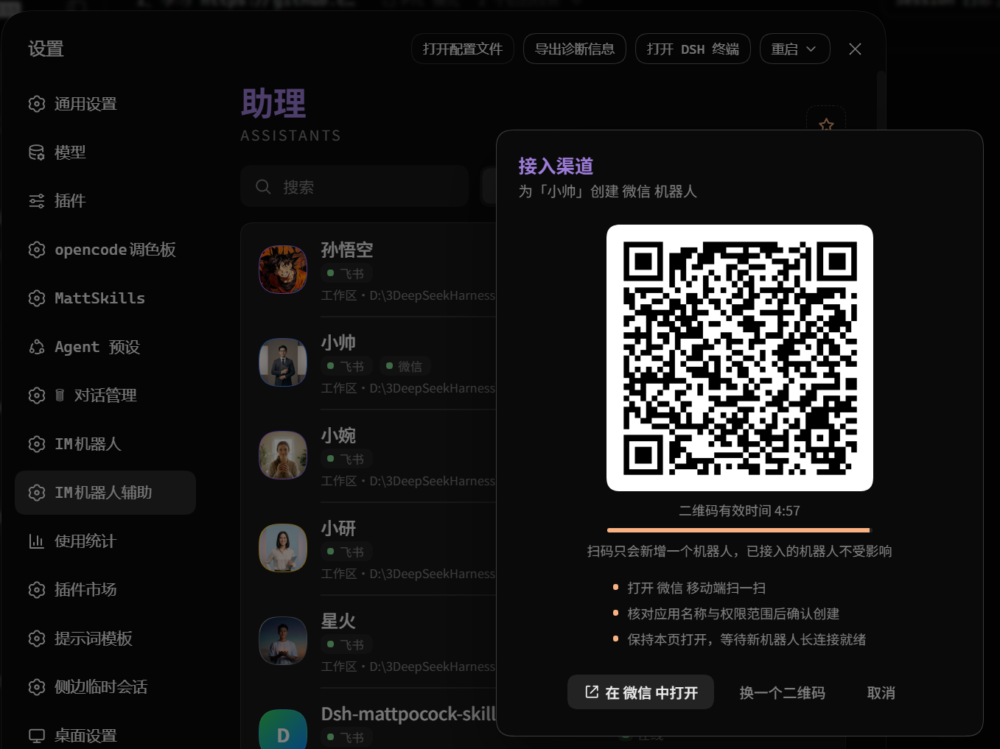

<strong>👇 点开助理卡：模式、状态、各渠道增强开关一目了然。</strong>

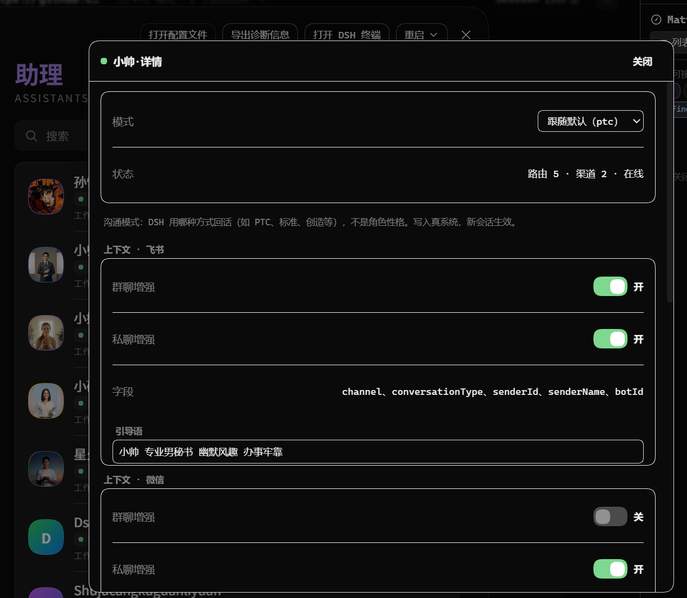

<strong>👇 舰队雷达：Agent × 渠道矩阵，全舰队谁在线一眼看清。</strong>

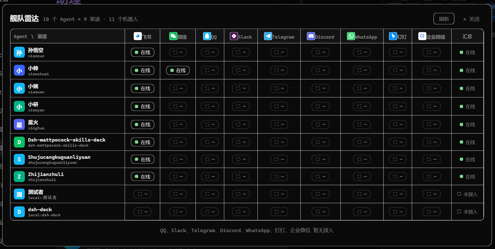

<strong>👇 会话状态一目了然（DSH增强）。</strong>

<div align="center">
<table>
<tr>
<td align="center" valign="top" width="50%">
<strong>👇 蓝条代表有会话在执行。</strong>
<br>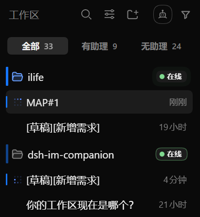
</td>
<td align="center" valign="top" width="50%">
<strong>👇 橙条代表有消息等你确认。点开后自动熄灭。</strong>
<br>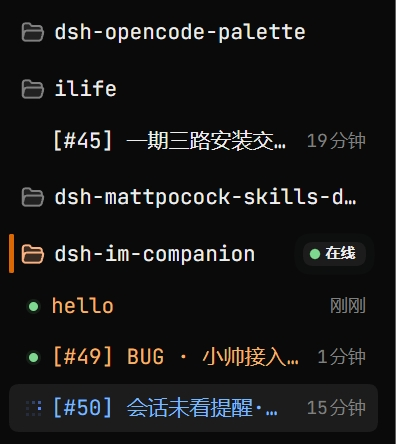
</td>
</tr>
</table>
</div>

<div align="center">
<table>
<tr>
<td align="center" valign="top" width="50%">
<strong>👇 悬停看双通道 + 最后检测时间</strong>
<br>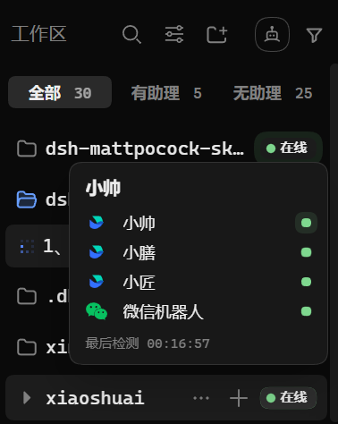
</td>
<td align="center" valign="top" width="50%">
<strong>👇 浅色主题同样可用</strong>
<br>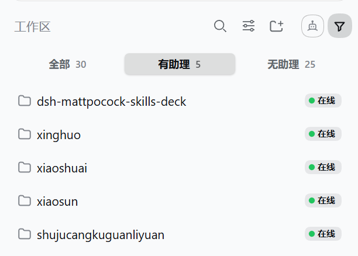
</td>
</tr>
</table>
</div>

<strong>👇 点工具栏机器人脸图标，进搬家面板</strong>

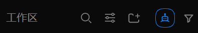

<strong>👇 串门搬家：把照片拖到另一家，二次确认。绿灯在岗，黄灯打盹，灰灯睡着。</strong>

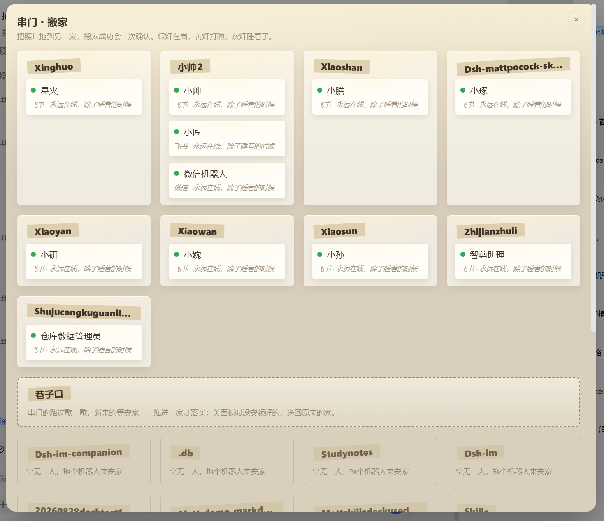

<strong>👇 卡片拖到另一家上空，目标家高亮</strong>

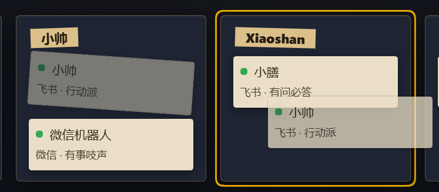

<strong>👇 搬家前二次确认</strong>

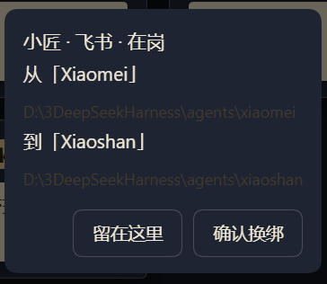

</div>

<h2 align="center"><sub>FAQ</sub><br>常见问题</h2>

<details open>
<summary>更新之后还是旧版本？</summary>

这是桌面端的应用市场缓存策略导致的：刚发布的版本几小时内更新会静默跳过。等几小时再更新；等不及就显式指定官方源装一次：

```bash
dsh plugin --profile desktop add dsh-im-companion@latest --registry https://registry.npmjs.org
```

</details>

<h2 align="center"><sub>MORE</sub><br>作者的其他作品</h2>

<div align="center">

<div align="left">

**[dsh-opencode-palette](https://github.com/FeatherHunter/dsh-opencode-palette)** —— 38 款 opencode 经典配色 + 20+自定义主题 一键换装 DSH

**[dsh-mattpocock-skills-deck](https://github.com/FeatherHunter/dsh-mattpocock-skills-deck)** —— 近 30 万 star 的 mattpocock/skills 整套预置好（27 个技能），装好即用。

**[dsh-prompt](https://github.com/FeatherHunter/dsh-prompt)** —— 经常反复重复的模板化提示词，存成自定义模板，选中后直接注入，不再需要耗费精力。

**[ilife](https://github.com/FeatherHunter/ilife)** —— 爱生活：居家生活套件，记账、运动、饮食、体重、食谱、物品管理、作息规划、备忘录等。⚠️建设中⚠️待正式发布

</div>

---

有任何问题、建议、意见、想法、IDEA、交流、吐槽，都欢迎[提交 ISSUE](https://github.com/FeatherHunter/dsh-im-companion/issues)！🌹

</div>

<h2 align="center"><sub>THANKS</sub><br>致谢</h2>

<div align="left">

感谢每一位提交 Issue、PR 与参与讨论的朋友。

<!-- THANKS-TABLE-ZH-START -->
| 贡献者 | 致敬 | 贡献 |
| --- | --- | --- |
| [@cxin21](https://github.com/cxin21) | 🌹🌹 | [#154](https://github.com/FeatherHunter/dsh-im-companion/issues/154) [#155](https://github.com/FeatherHunter/dsh-im-companion/issues/155) |
| [@vk-liu-cn-1](https://github.com/vk-liu-cn-1) | 🌹 | [#97](https://github.com/FeatherHunter/dsh-im-companion/issues/97) |
| [@Shimmernight](https://github.com/Shimmernight) | 🌹 | [#78](https://github.com/FeatherHunter/dsh-im-companion/issues/78) |
<!-- THANKS-TABLE-ZH-END -->

也感谢上游 [dsh-im](https://github.com/xmanrui/dsh-im)：没有本体，就没有本插件。

</div>

<h2 align="center"><sub>CONNECT</sub><br>加入我们</h2>

<div align="center">

Bug 与需求请直接提 ISSUE，更高效可追溯。

[提交 ISSUE](https://github.com/FeatherHunter/dsh-im-companion/issues) · [上游 dsh-im](https://github.com/xmanrui/dsh-im)

**👇 DSH插件交流群（飞书），扫码加入：**


</div>

---

<div align="center">

<picture>
  <source media="(prefers-color-scheme: dark)" srcset="https://raw.githubusercontent.com/FeatherHunter/dsh-im-companion/master/docs/star-history-dark.svg?v=20261021" />
  <source media="(prefers-color-scheme: light)" srcset="https://raw.githubusercontent.com/FeatherHunter/dsh-im-companion/master/docs/star-history-light.svg?v=20261021" />
  
</picture>

<sub>左轴读总星标（Total Stars），右轴读每日新增（Daily New），每天自动更新。</sub>

</div>